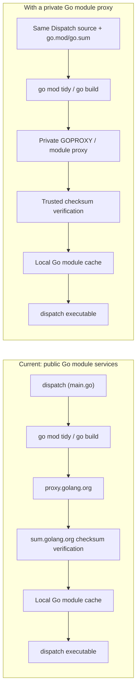

# Go build

## What Go is

Go is a compiled programming language and toolchain. It reads the source code and dependencies, compiles them, and creates a standalone executable. The Go build tool is used to create the Dispatch service executable.

## Full Go build cycle

For a Go service, the cycle is:

1. **Create or update the source** — the developer writes Go code such as `main.go`.
2. **Initialize the module** — `go mod init` creates `go.mod` and defines the module name.
3. **Discover dependencies** — `go mod tidy` finds imported packages and adds required modules to `go.mod`.
4. **Record the module versions** — `go mod tidy` creates or updates `go.sum` with dependency checksums.
5. **Resolve and download** — Go downloads modules from the configured module proxy or source.
6. **Compile** — Go compiles the source code and dependencies.
7. **Link** — Go links the compiled code into one standalone executable.
8. **Deploy and run** — the executable is placed on the server and started by the service.

Dispatch currently has no checked-in `go.mod` or `go.sum`, so the module setup is generated before the build.

## Service

This process builds **Dispatch**, from the top-level `dispatch` folder. The extracted archive contains `main.go` but no `go.mod` or `go.sum`.

## Build manually

Install the Go toolchain. In PowerShell, run from the repository root:

```powershell
Set-Location .\dispatch
go mod init dispatch
go mod tidy
go build -o .\dispatch.exe .
```

The Windows output is `.\dispatch.exe`. To create the Linux executable used by the service deployment guide, run the same module commands in a Linux shell and use `go build -o ./dispatch .`. `go mod init` and `go mod tidy` create `go.mod` and `go.sum`; review and commit those files so later builds resolve the same module versions. The deployment guide runs the resulting binary with its required environment.

## Dependency repository and architecture

Because there is no checked-in module file, `go mod tidy` first discovers imported modules and resolves their versions. Go uses **proxy.golang.org** by default and verifies public module checksums through **sum.golang.org**; modules are also cached locally.



For a private setup, configure `GOPROXY` to the organization's Go module proxy, which can cache approved public modules and serve internal modules. Retain checksum verification; configure the organization's checksum service or `GOSUMDB` policy rather than disabling verification. Keep proxy credentials in the build environment, not in the repository.

### Sample private Go configuration

Configure these values for the build process or in the Go environment. Example Linux environment:

```shell
export GOPROXY="https://packages.example.com/repository/go-group/"
export GONOPROXY="none"
export GOSUMDB="sum.golang.org"
```

The equivalent persistent PowerShell configuration is:

```powershell
go env -w GOPROXY="https://packages.example.com/repository/go-group/"
go env -w GONOPROXY="none"
go env -w GOSUMDB="sum.golang.org"
```

- `GOPROXY` sends module download requests to the private Go module proxy.
- `GONOPROXY=none` prevents Go from bypassing the proxy for private module paths.
- `GOSUMDB` specifies the checksum service used to verify downloaded modules.
- `GOPRIVATE` can identify private module paths and stop Go from sending them to the public checksum database:

```text
GOPRIVATE=git.example.com/company/*
GONOPROXY=git.example.com/company/*
```

Set private module credentials through Git, a credential helper, or CI secrets. Do not place tokens or passwords in `go.mod`, `go.sum`, or shell scripts committed to source control.

Verify and run the build:

```powershell
go env GOPROXY GONOPROXY GOPRIVATE GOSUMDB
go mod tidy
go build -o .\dispatch.exe .
```
