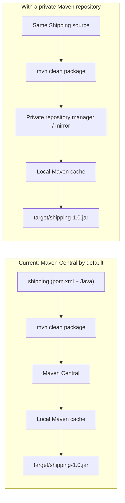

# Java and Maven build

## What Maven is

Maven is a build tool for Java projects. It reads `pom.xml`, downloads Java libraries, compiles the source code, runs build steps, and packages the application as a JAR file. Maven can also manage project structure and build settings.

## Full Maven build cycle

Maven defines a standard build lifecycle with these common phases:

1. **Validate** — Maven checks that the project structure and configuration are valid.
2. **Compile** — Maven downloads dependencies and compiles Java source code into `.class` files.
3. **Test** — Maven runs the project's unit tests.
4. **Package** — Maven packages the compiled application and resources into a JAR or other artifact.
5. **Verify** — Maven runs verification checks and integration tests, if configured.
6. **Install** — Maven installs the generated JAR into the local Maven repository for reuse by local projects.
7. **Deploy** — Maven publishes the artifact to a remote repository for sharing or delivery.

The `mvn clean package` command runs the lifecycle from the clean step through packaging. Shipping uses this command to create `target/shipping-1.0.jar`. The clean step removes the previous `target` directory before a fresh build.

## Service

This process builds **Shipping**, from the top-level `shipping` folder. The project descriptor is `pom.xml`; it targets Java 8 and packages a JAR.

## Build manually

Install a JDK compatible with the project's Java 8 target and Maven. Run from PowerShell at the repository root:

```powershell
Set-Location .\shipping
mvn clean package
```

The output is `.\target\shipping-1.0.jar`. Run it with the environment and service configuration described in [08-shipping.MD](../08-shipping.MD). No extra `mv` step is needed when running directly from the build folder; the deployment guide's rename is only for its `/app/shipping.jar` layout.

## Dependency repository and architecture

The `pom.xml` does not declare a custom repository. Maven therefore resolves the Spring Boot parent and dependencies from **Maven Central** by default, using any applicable Maven settings on the machine. Maven also caches downloaded artifacts locally.



For a private setup, configure Maven's `settings.xml` to mirror Central through the organization's repository manager. It can proxy approved public artifacts and host internal artifacts; keep repository credentials outside the source tree. The project `pom.xml` remains the dependency declaration in either setup.

### Sample private Maven configuration

Create or update Maven's protected settings file:

- Linux/macOS: `~/.m2/settings.xml`
- Windows: `%USERPROFILE%\.m2\settings.xml`

```xml
<settings xmlns="http://maven.apache.org/SETTINGS/1.0.0">
  <servers>
    <server>
      <id>private-maven</id>
      <username>${env.MAVEN_REPO_USER}</username>
      <password>${env.MAVEN_REPO_PASSWORD}</password>
    </server>
  </servers>

  <mirrors>
    <mirror>
      <id>private-maven</id>
      <name>Company Maven group</name>
      <mirrorOf>*</mirrorOf>
      <url>https://packages.example.com/repository/maven-group/</url>
    </mirror>
  </mirrors>
</settings>
```

- `<server>` defines credentials associated with the repository ID.
- `<mirrorOf>*</mirrorOf>` routes Maven repository requests through the private group.
- `mirrorOf` means repositories already declared in `pom.xml` or Maven defaults are mirrored.
- `${env.MAVEN_REPO_USER}` and `${env.MAVEN_REPO_PASSWORD}` are read from environment variables.
- The project `pom.xml` should not contain passwords or registry credentials.

Set credentials in the build environment, verify effective settings, and build:

```powershell
$env:MAVEN_REPO_USER = "read-only-build-user"
$env:MAVEN_REPO_PASSWORD = "read-only-build-password"
mvn -s "$env:USERPROFILE\.m2\settings.xml" help:effective-settings
mvn -s "$env:USERPROFILE\.m2\settings.xml" clean package
```
