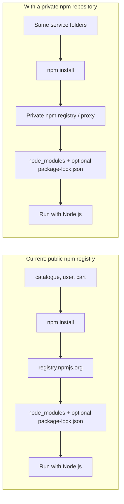

# Node.js and npm build

## What npm is

npm is the package manager for Node.js. It reads `package.json`, downloads the libraries used by a service, and places them in `node_modules`. npm does not compile JavaScript applications; it prepares the dependencies that Node.js needs to run `server.js`.

## Full npm build cycle

For a Node.js service, the cycle is:

1. **Create or update the source** — the developer writes `server.js` and declares dependencies in `package.json`.
2. **Resolve dependencies** — npm reads `package.json` and finds the required package versions.
3. **Fetch packages** — npm downloads dependencies from npm's configured registry.
4. **Install locally** — npm creates `node_modules` and may create or update `package-lock.json`.
5. **Run lifecycle scripts** — npm runs configured package scripts, if defined.
6. **Run or deploy** — Node.js executes `server.js`; no compilation is required.

Use `npm install` while developing. In CI or deployment, use `npm ci` when a reviewed `package-lock.json` exists.

## Services

This shared process applies to **Catalogue**, **User**, and **Cart**. Their source folders are `catalogue`, `user`, and `cart` at the repository root; each has its own `package.json`.

## Build manually

Run these commands in PowerShell from the repository root, once for each service:

```powershell
Set-Location .\catalogue
npm install
```

Repeat with `.\user` and `.\cart`. `npm install` reads `package.json` and downloads dependencies; these services are JavaScript applications and have no separate compile step. Start them with the runtime configuration described in their service guides.

The archives do not include `package-lock.json`. `npm install` may create one; commit and use a reviewed lockfile for repeatable builds. Once a lockfile is present, use `npm ci` in CI to install its exact dependency tree.

## Dependency repository and architecture

With the current setup, npm's default registry is **https://registry.npmjs.org/**. `npm config get registry` shows the registry configured on the machine. Source code is already in this repository; package dependencies are fetched separately from that registry.



For a private setup, configure the organization's npm registry (for example, a repository-manager proxy) in `.npmrc` or the build environment. Keep registry credentials in a secret store, not in this repository. The private registry should proxy approved public packages and host any internal packages.

### Sample private npm configuration

Create `.npmrc` beside `package.json`. Replace the example host and repository name with the values supplied by your repository administrator:

```ini
registry=https://packages.example.com/repository/npm-group/
//packages.example.com/repository/npm-group/:_authToken=${NPM_TOKEN}
always-auth=true
```

- `registry` sends package searches and installs through the private npm group.
- `_authToken` supplies npm with a token for private or authenticated packages.
- `NPM_TOKEN` is an environment variable; it must not be written directly into `.npmrc` or source control.
- `always-auth=true` sends authentication for requests that require it.

Set the token in the build environment, then verify and install:

```powershell
$env:NPM_TOKEN = "read-only-build-token"
npm config get registry
npm ci
```

Use `npm ci` for repeatable CI builds only when a reviewed `package-lock.json` is committed.
