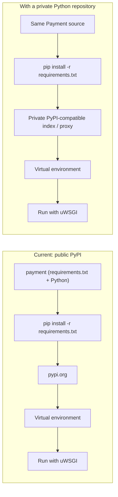

# Python and pip dependency setup

## What pip is

pip is the package installer for Python. It reads `requirements.txt`, downloads the listed libraries, and installs them into a Python environment. pip prepares dependencies but does not compile this application's Python source code.

## Full pip dependency cycle

For a Python service, the cycle is:

1. **Create an environment** — create a virtual environment so packages are isolated from system Python.
2. **Choose a package index** — pip uses the configured index, such as PyPI or a private repository.
3. **Read dependencies** — pip reads the package names and versions from `requirements.txt`.
4. **Resolve versions** — pip resolves dependencies and checks which packages are already available.
5. **Fetch packages** — pip downloads source distributions or prebuilt wheels from the index.
6. **Install dependencies** — pip installs the packages and their sub-dependencies into the environment.
7. **Run or deploy** — the application is started by uWSGI or another process using the prepared environment.

The current Payment dependencies are not pinned to exact versions. Pin reviewed versions or use a constraints/lock file when repeatability is required.

## Service

This process prepares the dependencies for **Payment**, from the top-level `payment` folder. Its dependency list is `requirements.txt`.

## Prepare manually

On the Rocky/RHEL Linux environment used by the service, run from the repository root:

```shell
cd payment
python3 -m venv .venv
source .venv/bin/activate
python -m pip install --upgrade pip
python -m pip install -r requirements.txt
```

This installs Python packages into the virtual environment; the Payment source has no separate compile/package step. Start it with uWSGI and the settings in `payment.ini`, as described in [10-payment.MD](../10-payment.MD). If using the virtual environment for deployment, point the service to its uWSGI executable.

The current requirements are not version-pinned, so a later install may resolve newer package versions. Pin and review versions for repeatable production builds.

## Dependency repository and architecture

The requirements file does not configure an index. pip uses **PyPI (https://pypi.org/simple)** by default, and caches downloaded distributions locally.



For a private setup, point pip to the organization's PyPI-compatible proxy or index using managed pip configuration or `--index-url`. Prefer one trusted index that proxies approved public packages and hosts internal packages; avoid putting credentials in source files or using an untrusted secondary index.

### Sample private pip configuration

Create a protected pip configuration file:

- Linux/macOS: `~/.config/pip/pip.conf`
- Windows: `%APPDATA%\pip\pip.ini`

```ini
[global]
index-url = https://packages.example.com/repository/pypi-group/simple
trusted-host = packages.example.com
timeout = 60

[install]
only-binary = :all:
```

- `index-url` makes pip download through the private PyPI-compatible repository.
- `trusted-host` marks the repository host as trusted. TLS verification should remain enabled; use this setting only if your organization requires it for a correctly configured private host.
- `timeout` sets the maximum wait for a repository response.
- `only-binary = :all:` prefers wheels and does not build source distributions. Remove or change this only when the organization approves source installs.

For an authenticated private index, store credentials in pip's approved keyring or environment variables rather than in `pip.conf`. A build-process example is:

```shell
export PIP_INDEX_URL="https://packages.example.com/repository/pypi-group/simple"
export PIP_EXTRA_INDEX_URL=""
python3 -m pip install -r requirements.txt
python3 -m pip config debug
```

Prefer one trusted index. Do not add another public or untrusted index as `PIP_EXTRA_INDEX_URL`, because multiple indexes can allow package-name confusion.
